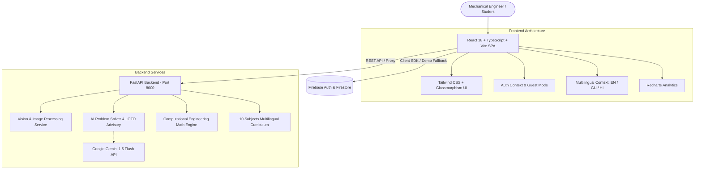

# MechNova – Intelligent Mechanical Assistant
> **"તમારો સ્માર્ટ મિકેનિકલ સહાયક"** | *Your Intelligent Mechanical Assistant*

[](https://python.org)
[](https://fastapi.tiangolo.com)
[](https://react.dev)
[](https://www.typescriptlang.org)
[](https://tailwindcss.com)
[](https://firebase.google.com)

**MechNova** is a comprehensive, production-ready, AI-powered mechanical engineering assistant and plant reliability management platform engineered for engineering students, maintenance technicians, condition monitoring specialists, and industrial plant managers.

---

## 1. Visual Branding & Design System

- **Background:** Deep Navy Blue (`#0B1F3B`) with engineered subtle blueprint grid
- **Primary Color:** Industrial Blue (`#007BFF`)
- **Accent Color:** High-visibility Cyan Glow (`#4FC3FF`)
- **Card Surfaces:** High-contrast Dark Slate (`#102A4E` & `#061224`) with rounded borders
- **Typography:**
  - English: **Poppins** (Google Fonts)
  - Gujarati: **Noto Sans Gujarati** (Google Fonts)
  - Monospace Math/Data: **JetBrains Mono**
- **Logo:** Custom precision SVG vector mark with an 8-tooth involute gear, stylized beveled letter **M**, and an integrated mechanical caliper/checkmark motif.

---

## 2. System Architecture



---

## 3. Core Functional Modules

### 1. Identify a Part (AI Computer Vision)
- **Camera snapshot & device upload** with live video stream capture.
- Real-time contour, aspect ratio, edge density, and metallic luster heuristic analysis.
- Classification of **Gears, Bearings, Shafts, Pulleys, Pumps, Valves, and Fasteners**.
- Detailed outputs: visible features, engineering functions, possible metallurgy/materials, common machinery applications, failure modes, safety precautions, and confidence gauge.
- Includes uncertainty disclaimer ensuring compliance with engineering safety standards.

### 2. AI Mechanical Problem Solver & LOTO Safety
- Troubleshooting workflow for pumps, gearboxes, motors, compressors, CNC spindles, etc.
- Root causes ranked by probability (High, Medium, Low).
- Step-by-step diagnostic procedures with expected observations and safety checks.
- Prominent **OSHA 29 CFR 1910.147 Lockout/Tagout (LOTO)** zero-energy isolation advisories.
- Interactive conversational chat interface for follow-up diagnostic inquiries.

### 3. Engineering Study Assistant (10 Subjects)
- Multilingual support: **English, ગુજરાતી (Gujarati), and हिंदी (Hindi)**.
- Covers:
  1. Engineering Mechanics
  2. Thermodynamics
  3. Fluid Mechanics
  4. Strength of Materials (SOM)
  5. Theory of Machines (TOM)
  6. Machine Design (DME)
  7. Manufacturing Processes
  8. Heat Transfer
  9. Engineering Materials
  10. Engineering Mathematics
- Includes topic lessons, formula reference sheets, worked numericals, **5-mark and 10-mark university exam answer formats**, and practice MCQs with instant scoring feedback.

### 4. Precision Engineering Calculator (12 Calculators)
- **Stress & Strain** ($\sigma = F/A$, $\varepsilon = \Delta L/L_0$)
- **Young's Modulus** ($E = \sigma/\varepsilon$)
- **Torque & Power** ($P = 2\pi N T / 60,000$)
- **Gear Ratio & Output RPM** ($i = Z_2/Z_1 = N_1/N_2$)
- **Mechanical Efficiency & Energy Loss** ($\eta = P_{out}/P_{in} \times 100\%$)
- **Pressure & Force** ($P = F/A$)
- **Fourier's Conduction Heat Transfer** ($Q = k A \Delta T / L$)
- **Fluid Flow Rate & Pipe Velocity** ($Q = A \cdot v$)
- **Thermodynamic Carnot Efficiency** ($\eta = 1 - T_L/T_H$)
- **Density, Specific Weight & Specific Gravity**
- **Engineering Unit Converter** (bar to psi, kW to HP, MPa to psi, °C to K)
- Displays governing formulas, step-by-step mathematical substitutions, and explicit engineering assumptions.

### 5. Maintenance Management (Fleet Asset Manager)
- Complete CRUD operations for industrial equipment assets.
- Machine Tag IDs, serial numbers, models, installation dates, and locations.
- Status tracking: *Operational*, *Maintenance Due*, *Critical*, and *Under Repair*.
- Maintenance event logs with fault descriptions, corrective actions, parts replaced, technician names, and costs.
- Overdue maintenance alerts and **CSV / JSON data export**.

### 6. Machine Knowledge Library
- Technical reference articles verified against international engineering standards:
  - **ISO 281** (Rolling bearings rating life)
  - **AGMA 2001-D04** (Gear rating and pitting resistance)
  - **ASME B106.1M** (Design of transmission shafting)
  - **AWS D1.1** (Structural welding codes)
  - **OSHA 1910.147** (Hazardous energy control & LOTO)
  - **ASM International** (Properties of structural alloys)

### 7. Fleet Operations & Admin Control
- Equipment status distribution and monthly maintenance spend analytics powered by **Recharts**.
- Role-Based Access Control (Student, Technician, Reliability Engineer, Administrator).

---

## 4. Database Structure & Firestore Schema

```json
{
  "users": {
    "{uid}": {
      "displayName": "string",
      "email": "string",
      "preferredLanguage": "en | gu | hi",
      "role": "student | technician | engineer | admin",
      "organization": "string",
      "createdAt": "timestamp"
    }
  },
  "equipment_records": {
    "{record_id}": {
      "userId": "string",
      "machine_id": "PMP-SL-301",
      "name": "Centrifugal Slurry Pump #3",
      "manufacturer": "Kirloskar Brothers",
      "model": "DB-150/32",
      "status": "Operational | Maintenance Due | Critical | Under Repair",
      "installation_date": "YYYY-MM-DD",
      "next_service_date": "YYYY-MM-DD",
      "location": "Bay 2",
      "maintenance_history": [
        {
          "date": "YYYY-MM-DD",
          "fault_description": "Mechanical seal leakage",
          "action_taken": "Replaced cartridge seal",
          "parts_replaced": "SiC Seal",
          "cost": 450
        }
      ]
    }
  },
  "saved_history": {
    "{item_id}": {
      "userId": "string",
      "type": "part | troubleshoot | calc | study",
      "title": "string",
      "timestamp": "ISO8601",
      "data": "object"
    }
  }
}
```

---

## 5. Quick Start & Installation

### Prerequisites
- Python 3.10+
- Node.js 18+ (A portable Node.js v20 runtime is already included in `tools/`)

### Setup Instructions
1. Clone the repository or navigate to workspace:
   ```bash
   cd d:\mechnova
   ```

2. Install Python backend dependencies:
   ```bash
   pip install -r backend/requirements.txt
   ```

3. Install frontend dependencies:
   ```bash
   cd frontend
   npm install
   cd ..
   ```

4. Launch both Backend & Frontend:
   - On Windows: Simply run `run.bat` or `run.ps1`
   - Or manually in two terminal tabs:
     ```bash
     # Tab 1 - Backend:
     python -m uvicorn backend.main:app --host 127.0.0.1 --port 8000 --reload

     # Tab 2 - Frontend:
     cd frontend
     npm run dev
     ```

5. Access the application in your browser:
   - **Frontend UI:** `http://localhost:5173`
   - **FastAPI Interactive Swagger Docs:** `http://127.0.0.1:8000/docs`

---

## 6. Running Automated Tests

Run the backend unit test suite:
```bash
python backend/tests/run_tests.py
```
*Tests verify stress/strain, Young's modulus, torque & power, gear ratios, Carnot cycle efficiency, vision heuristic classification, and multilingual curriculum rendering.*

---

## 7. Deployment Instructions

### Frontend (Vercel)
1. Push project to GitHub.
2. Link the repository on [Vercel](https://vercel.com).
3. Set **Root Directory** to `frontend`.
4. The included `vercel.json` and Vite build configuration will build and serve the application with SPA client routing.
5. Add your optional Firebase environment variables in Vercel project settings.

### Backend (Python FastAPI)
Deploy to Render, Railway, or Fly.io:
```bash
uvicorn backend.main:app --host 0.0.0.0 --port $PORT
```
Set environment variables:
- `GEMINI_API_KEY` = Your Gemini API key
- `ENVIRONMENT` = production
